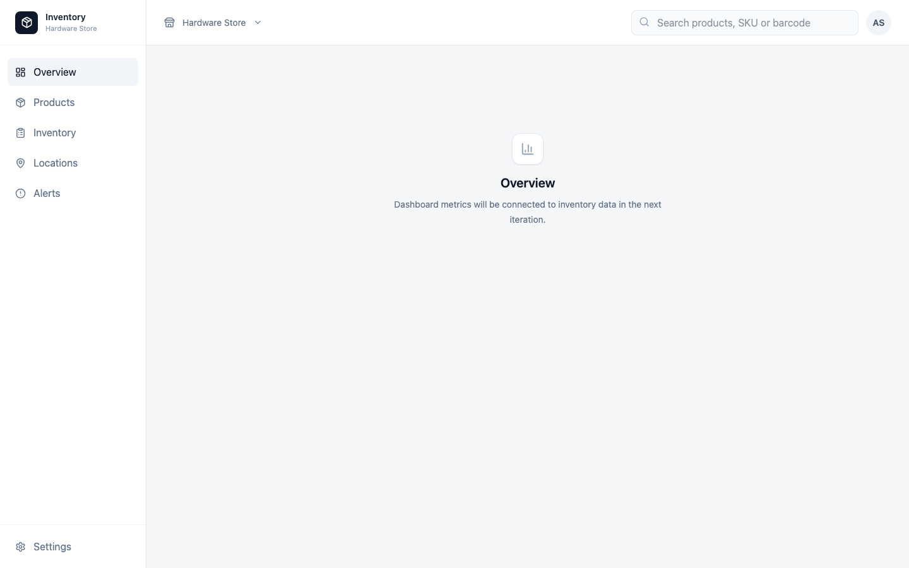
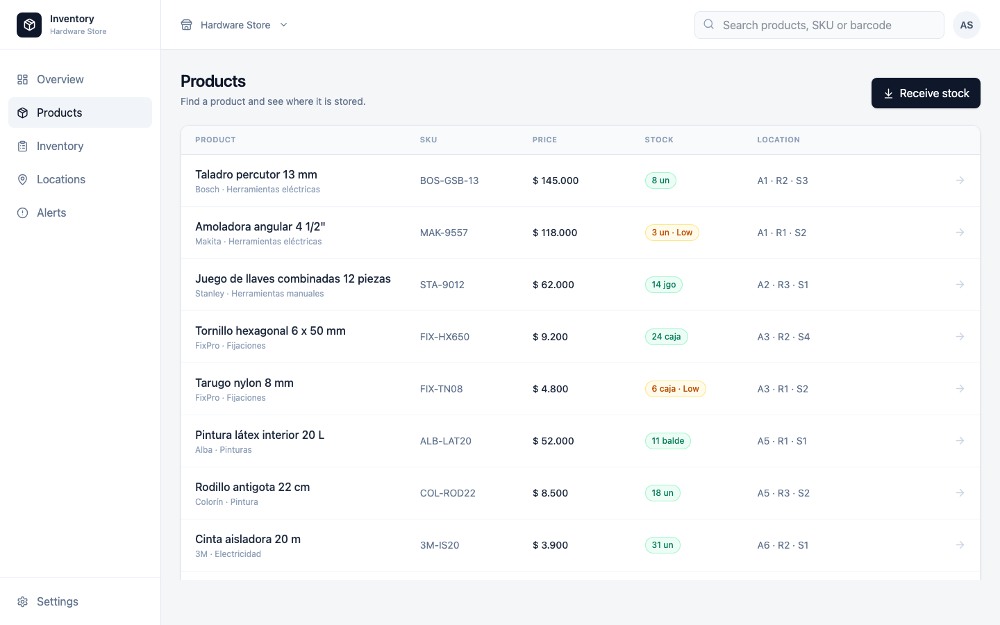
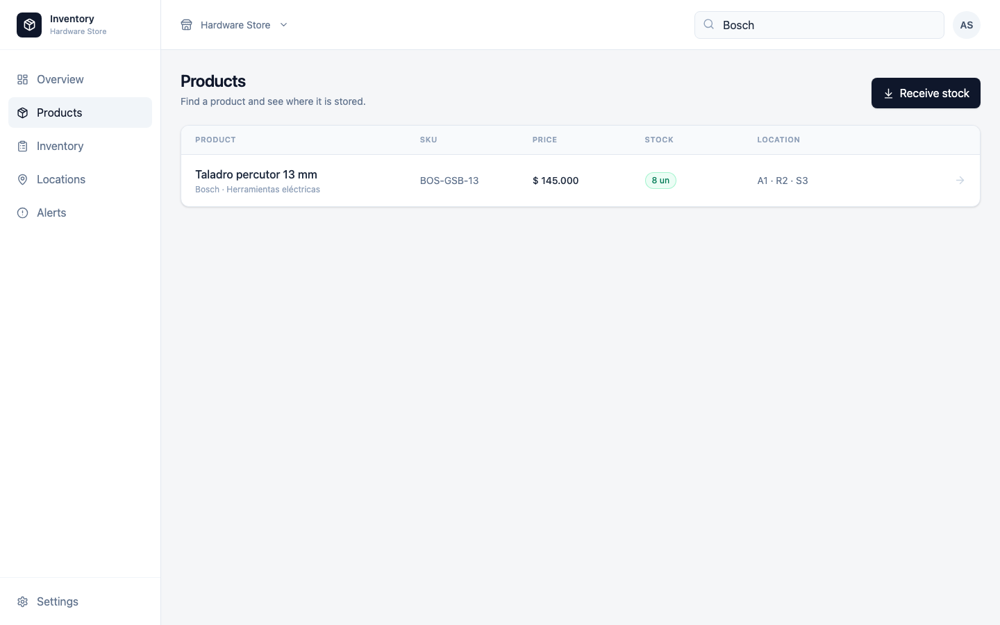
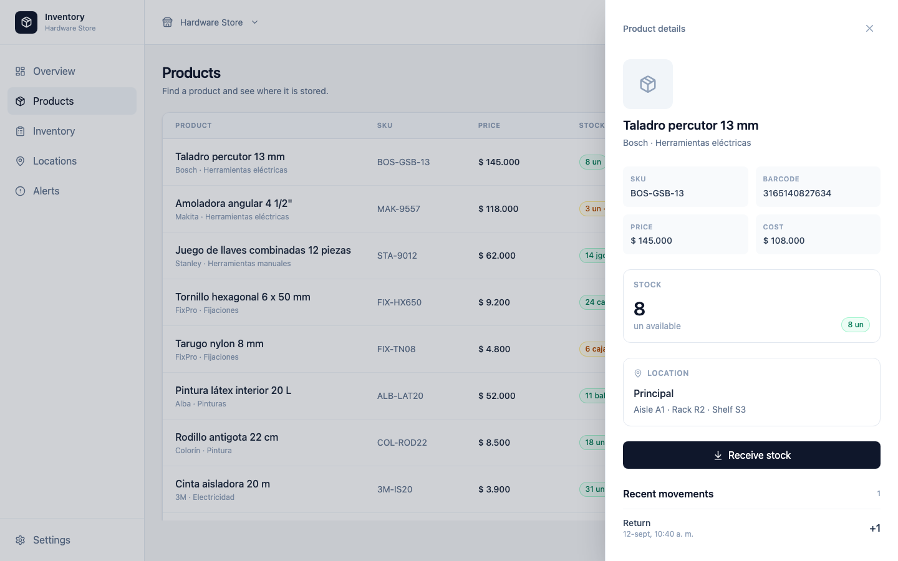
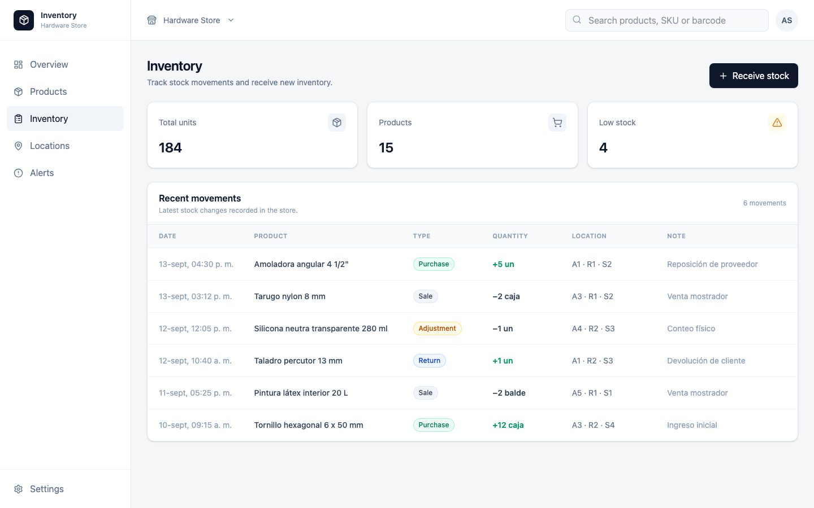
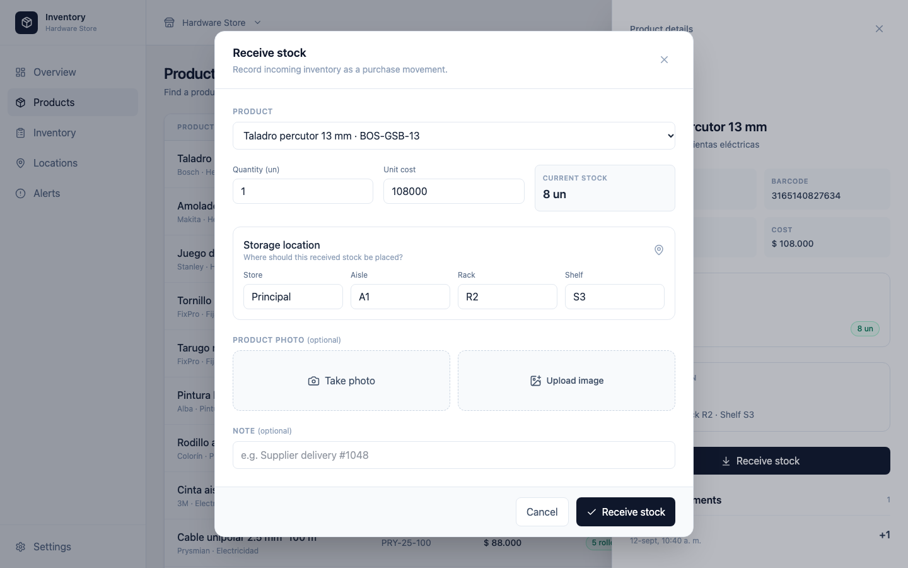
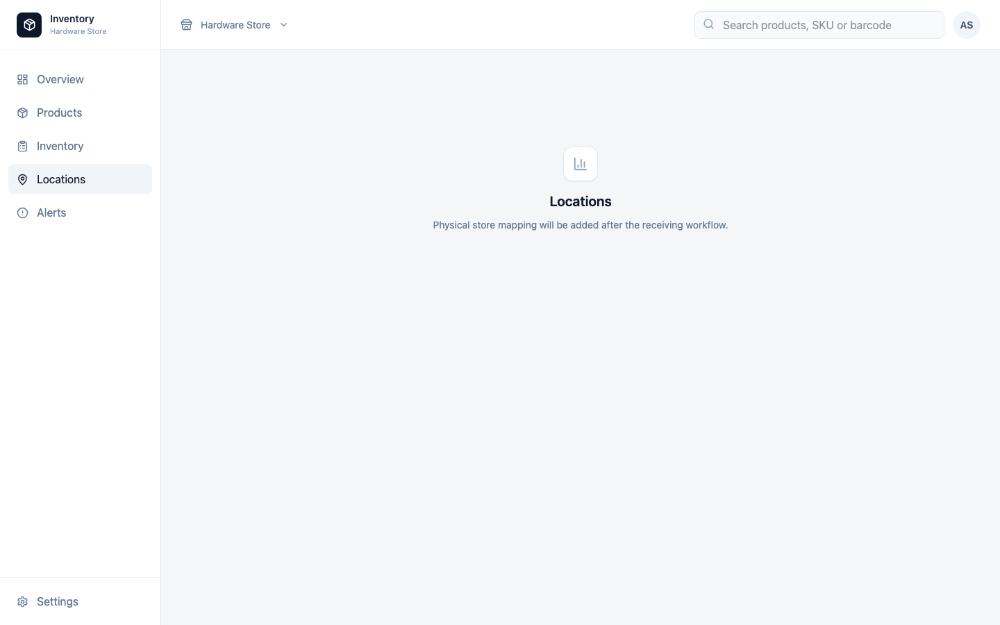
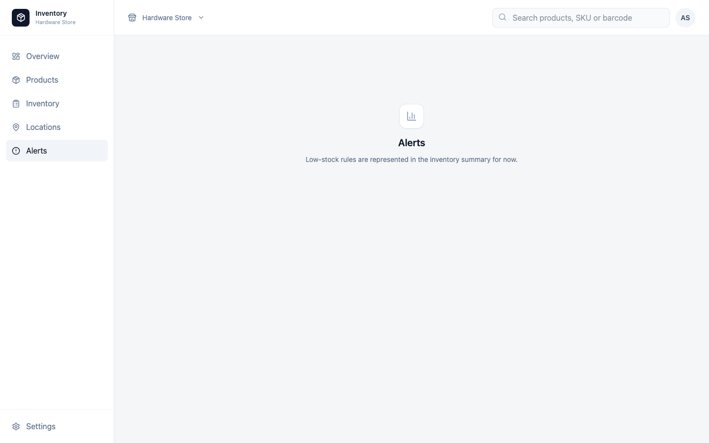

# 🛠️ Hardware Store Inventory — Native Desktop App (Tauri v2 + React 19)

A modern, offline-first cross-platform desktop inventory management system tailored for retail hardware stores and building supply depots (*ferreterías y corralones*). Built with **Tauri v2**, **React 19**, **TypeScript**, and **Tailwind CSS v4**.

> 📌 **Executive Documentation for Delivery Managers, Delivery Leads & Engineering Managers:**  
> A full architectural assessment, C4 system models, technical debt audit, user stories with Story Point estimations (Fibonacci), and risk matrix are documented in:  
> 👉 [**docs/ARCHITECTURE_AND_DELIVERY_PLAN.md**](docs/ARCHITECTURE_AND_DELIVERY_PLAN.md)

---

## 📌 Executive Summary

This application (Prototype Iteration 2) demonstrates an offline-first native desktop solution designed to streamline daily retail store operations:
- **Product Catalog & Physical Store Coordinates**: Real-time visibility into stock levels, pricing, cost, SKU, barcode, and physical warehouse coordinates (*Store · Aisle · Rack · Shelf*).
- **Double-Entry Movement Audit Trail**: Categorized movement tracking (`PURCHASE`, `SALE`, `RETURN`, `ADJUSTMENT`) with quantity deltas (`+` / `−`) and delivery notes.
- **Guided Stock Intake Workflow**: Operational intake modal for receiving incoming supplier shipments, updating stock balances instantly, reassigning shelf storage locations, and attaching product photos via file upload or **desktop camera capture**.
- **Real-Time Threshold Alerting**: Automatic safety badge indicators and summary cards identifying products below their minimum safety reorder threshold.

---

## 🎯 Stakeholder Matrix & Status Overview

| Stakeholder Role | Primary Value Delivered | Key Technical / Delivery Deliverable | Status |
| :--- | :--- | :--- | :---: |
| **Delivery Manager (DM)** | Operational shrinkage prevention, supplier intake verification, and clear milestone visibility. | [Architecture & Delivery Blueprint](docs/ARCHITECTURE_AND_DELIVERY_PLAN.md) | 🟢 Approved Plan |
| **Delivery Lead (DL)** | User story backlog estimated in Story Points (61 SP total across 4 Sprints), DoR/DoD. | [WBS & User Story Backlog](docs/ARCHITECTURE_AND_DELIVERY_PLAN.md#4-delivery-roadmap--user-stories-delivery-lead--dm-view) | 🟡 Ready for Sprint 1 |
| **Engineering Manager (EM)** | Technical debt audit, C4 Architecture models, SQLite persistence strategy. | [C4 Architecture & Debt Audit](docs/ARCHITECTURE_AND_DELIVERY_PLAN.md#3-c4-architecture-specification) | 🟡 Refactor In Progress |

---

## 📸 Visual Walkthrough & Operational Workflows

### 1. Executive Overview & Operational KPIs
High-level operational dashboard displaying total active inventory, critical stockout warnings, store valuation, and quick shortcut actions for daily retail opening and closing.



---

### 2. Products Catalog & Physical Store Coordinates
Browse and filter the entire catalog. Each entry displays category, brand, SKU, retail price, stock level badges (with automatic "Low stock" warning indicators), and exact physical warehouse placement (*Store · Aisle · Rack · Shelf*).



---

### 3. Instant Search & Real-Time Filtering
Sub-millisecond live search by product name, brand, SKU, category, or barcode across all inventory items, enabling fast over-the-counter customer lookups.



---

### 4. Product Detail Inspector & Movement History
Clicking any item slides out a detailed inspector drawer showing SKU, barcode, retail price, purchase cost, current stock vs. threshold, location, direct **Receive Stock** action, and the chronological movement history for that specific SKU.



---

### 5. Inventory Audit Dashboard & Movement Ledger
The **Inventory** view provides operational KPI summary cards (*Total units in store*, *Active products*, *Low stock items requiring reorder*) along with a chronological movements table displaying timestamp, product, movement type badge, quantity delta (`+` / `−`), location, and delivery/adjustment notes.



---

### 6. Guided Stock Intake Workflow (with Camera & Photo Verification)
When receiving incoming supplier shipments, warehouse staff select the product, specify incoming quantity and unit cost, reassign or verify shelf storage location, add supplier notes, and attach a verification photo via file upload or integrated desktop webcam capture (`navigator.mediaDevices.getUserMedia()`).



---

### 7. Physical Storage Locations & Shelf Mapping
Dedicated warehouse coordinate view showing distribution of items across aisles, racks, and shelves to optimize warehouse picking and stock replenishment paths.



---

### 8. Low-Stock Safety Threshold Alerting
Automated reorder view isolating products currently at or below their safety stock levels, enabling store managers to generate purchase orders before stockouts occur.



---

## 🧱 Technology Stack

| Layer | Technology | Details |
| :--- | :--- | :--- |
| **Desktop Shell** | [Tauri v2](https://tauri.app/) (Rust) | Lightweight, memory-efficient native wrapper (1280×820 minimum responsive canvas) |
| **Frontend Framework** | [React 19](https://react.dev/) + [TypeScript](https://www.typescriptlang.org/) | Component-driven UI with strict typing |
| **Styling** | [Tailwind CSS v4](https://tailwindcss.com/) | Modern utility-first design system |
| **Bundler / Tooling** | [Vite 8](https://vite.dev/) | Sub-second HMR and optimized production bundling |
| **Iconography** | [Lucide React](https://lucide.dev/) | Clean, consistent icons |
| **Hardware Access** | WebRTC / `getUserMedia()` | Camera capture permissions requested on-demand |
| **Local Persistence (Roadmap)** | SQLite via `tauri-plugin-sql` | Embedded ACID relational persistence for offline-first reliability |

---

## 📂 Project Structure

```text
hardware-store-inventory/
├── docs/
│   ├── ARCHITECTURE_AND_DELIVERY_PLAN.md   # Comprehensive Technical & Delivery Blueprint
│   └── screenshots/                        # High-resolution screenshots for review
│       ├── 01-products-catalog.png
│       ├── 02-product-detail.png
│       ├── 03-inventory-movements.png
│       ├── 04-receive-stock-modal.png
│       ├── 05-product-search-filter.png
│       ├── 06-overview-dashboard.png
│       ├── 07-storage-locations.png
│       └── 08-low-stock-alerts.png
├── src/
│   ├── app/
│   │   └── App.tsx                         # Main layout, sidebar, catalog, drawer & modals
│   ├── data/
│   │   ├── index.ts                        # Mock seed dataset & initial movements
│   │   └── products.json                   # Sample hardware inventory catalog
│   ├── types/
│   │   └── inventory.ts                    # Domain models (Product, StockMovement, Location)
│   ├── main.tsx                            # React entry point
│   └── styles.css                          # Global typography & Tailwind styles
├── src-tauri/                              # Tauri v2 native configuration and Rust harness
│   ├── Cargo.toml
│   └── tauri.conf.json                     # Window sizes, permissions, build hooks
├── package.json
├── tsconfig.json
└── vite.config.ts                          # Vite + Tailwind configuration
```

---

## 🚀 Getting Started & Local Run

### Prerequisites
- [Node.js](https://nodejs.org/) (v20+ recommended)
- [Rust & Cargo](https://www.rust-lang.org/) *(only required if compiling the native Tauri desktop binary)*

### 1. Web Preview Mode (Quickest)
You can run and test the full application directly in any browser:

```bash
# Install dependencies
npm install

# Start Vite dev server on http://localhost:1420
npm run dev
```

### 2. Native Desktop Mode (Tauri)
To launch the native desktop application window:

```bash
npm run tauri dev
```

### 3. Production Build
```bash
# Build frontend bundle
npm run build

# Package desktop installer/binary (DMG/MSI/deb depending on OS)
npm run tauri build
```

### ⚙️ Optional Environment Variables
- `ALLOWED_HOSTS`: Comma-separated list of additional allowed hosts in Vite (useful if exposing via tunnels like ngrok for remote client testing).

---

## 🗺️ Scope & Roadmap (Delivery Plan)

See the full [Engineering & Delivery Plan](docs/ARCHITECTURE_AND_DELIVERY_PLAN.md) for detailed user stories and Story Point estimates.

- [x] **Iteration 1**: Initial catalog view, product data models, and basic layout.
- [x] **Iteration 2 (Current Prototype)**:
  - Inventory movements log (`PURCHASE`, `SALE`, `RETURN`, `ADJUSTMENT`).
  - Receive Stock workflow with immediate state updates.
  - Product details drawer with movement audit trail.
  - Physical warehouse coordinate tracking (*Store · Aisle · Rack · Shelf*).
  - Desktop camera capture and image upload support.
- [ ] **Iteration 3 (Sprint 1 & 2 — Architecture & Persistence)**:
  - Modularize `App.tsx` into clean feature components (`src/features/*`).
  - Centralize state management with Zustand store.
  - Set up Vitest test suite and testing coverage gates.
  - Implement offline-first SQLite database via `tauri-plugin-sql` with ACID transactions.
- [ ] **Iteration 4 (Sprint 3 & 4 — Hardware & Cloud Integration)**:
  - Global USB barcode scanner (HID listener).
  - Persist captured photos to local disk storage (`$APP_DATA/product_photos/`).
  - Connect to backend API (e.g. Ruby on Rails / PostgreSQL) for multi-branch sync.
  - User roles & authentication (Cashier, Store Manager, Warehouse Clerk).
