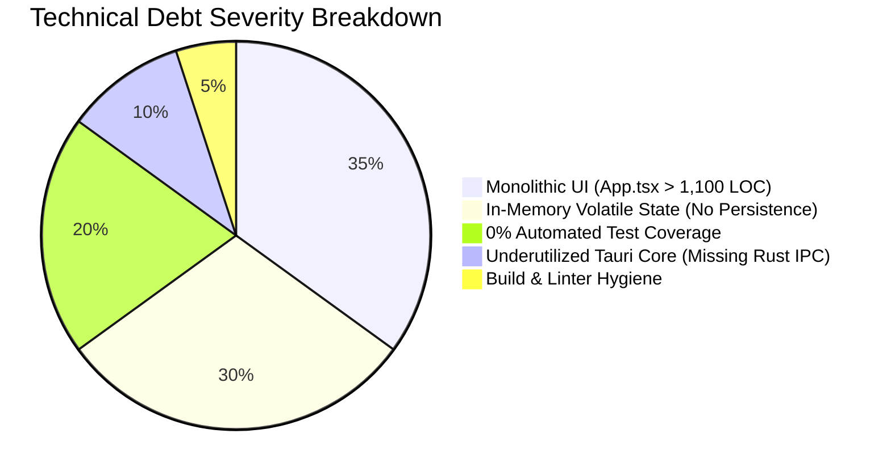
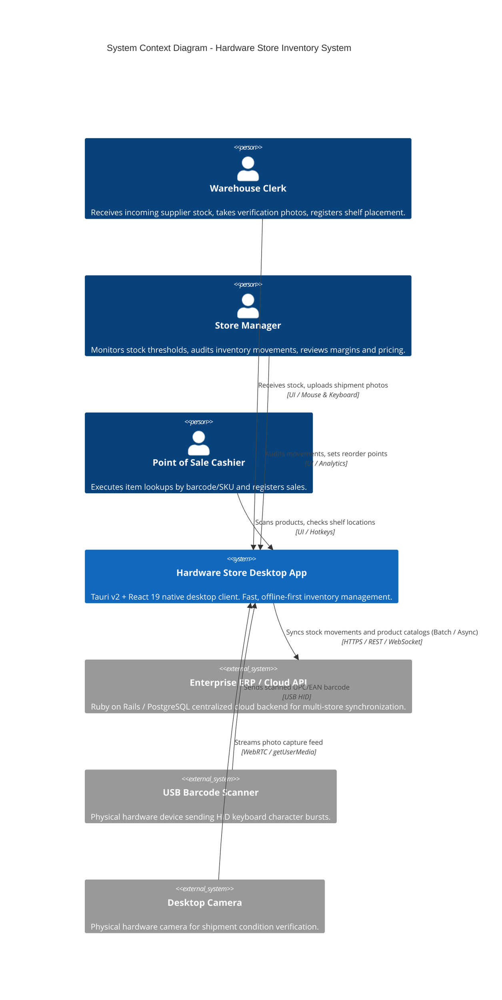
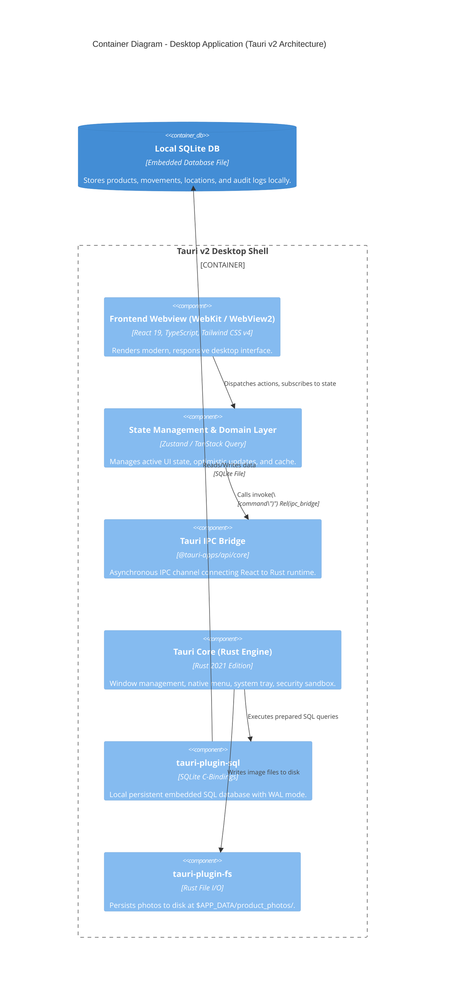
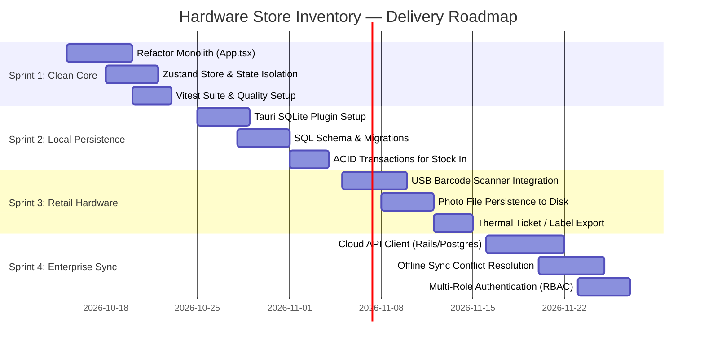

# 📋 Architecture Assessment & Delivery Plan

> **Document Classification:** Technical & Delivery Architecture Blueprint  
> **Target Audience:** Engineering Manager (EM), Delivery Manager (DM), Delivery Lead (DL), Product Owner (PO)  
> **System:** Hardware Store Inventory — Native Desktop Application (Tauri v2 + React 19)  
> **Current Version:** 0.2.0 (Prototype Iteration 2)  
> **Status:** Proposal & Execution Roadmap  

---

## 1. Executive Summary & Business Context

### 1.1 Problem Statement
Hardware retail hubs, builders\' supply depots, and tool stores (*ferreterías y corralones*) operate in high-density, physical-first retail environments. Key operational pain points include:
1. **Stock Discrepancies & Stockouts:** Slow manual inventory counts cause sudden stockouts of high-velocity SKUs (fasteners, power tools, specialized coatings, plumbing connectors).
2. **Physical Warehouse Disorganization:** Items are misplaced across secondary warehouses, aisles, racks, and shelves without recorded physical coordinates, leading to staff search fatigue and order delays.
3. **Unverified Shipments Intake:** Incoming supplier goods are frequently unloaded without photographic proof or immediate stock reconciliation.
4. **Network Unreliability in Warehouse Bays:** Many warehouse basements or yard areas experience spotty Wi-Fi, making purely cloud-dependent web apps unstable.

### 1.2 Strategic Solution
A lightweight, offline-first **Native Desktop Application** built with **Tauri v2 (Rust engine shell)** and **React 19 + TypeScript**:
- **Offline Resilience:** Sub-millisecond latency; operates completely locally even when internet connection drops.
- **Physical Coordinates:** First-class store coordinates (*Store · Aisle · Rack · Shelf*) for instant physical locating.
- **Auditable Stock Movements:** Double-entry-style ledger categorizing every unit change (`PURCHASE`, `SALE`, `RETURN`, `ADJUSTMENT`).
- **Hardware Integration:** Direct desktop camera capture for shipment photographic proof, plus USB barcode scanner listeners.

---

## 2. Technical Debt & "Toy Project" Assessment (Engineering Manager View)

While Iteration 2 achieves functional prototype completeness for demo purposes, the codebase currently suffers from architectural shortcuts that prevent it from being production-ready:



### 2.1 Critical Debt Items

| Area | Current State ("Toy Project") | Target State (Production Architecture) | Severity | Refactor Epic |
| :--- | :--- | :--- | :---: | :--- |
| **Monolithic UI Component** | [App.tsx](file:///src/app/App.tsx) has **1,100+ lines**. It bundles routing, layout, modals, drawers, camera streaming, and business calculations in a single component. | Modular feature-based directory structure (`src/features/*`), presentation components (`src/components/ui/*`), and custom domain hooks. | **CRITICAL** | Epic 1 |
| **State & Persistence** | State is held strictly in memory via React `useState(mockProducts)` and `useState(mockMovements)`. Reloading or closing the application loses all data. | Local relational database using `tauri-plugin-sql` (SQLite) with migrations, WAL mode, and ACID transactions. | **BLOCKER** | Epic 2 |
| **Test Automation** | **0% coverage**. No testing framework installed (no Vitest, React Testing Library, or Playwright). | Vitest unit test suite for domain calculations + React Testing Library for feature flows + Playwright/Tauri WebDriver for desktop E2E. | **HIGH** | Epic 1 |
| **Tauri Core Utilization** | Tauri v2 functions solely as a Webview window shell; no Rust commands or plugins are registered. | Rust layer handles SQLite database connection, system file storage for captured photos, and hardware event listeners. | **HIGH** | Epic 2 & 3 |
| **Photo & Asset Storage** | Camera photos are converted to in-memory Base64 data URLs. This causes memory bloat and potential crash under heavy usage. | Captured images saved to disk via Tauri filesystem API (`$APP_DATA_DIR/photos/`) and referenced via relative file paths. | **MEDIUM** | Epic 3 |
| **Code Quality & Tooling** | No linter configured (`npm run lint` missing); Node 20.17 engine warning under Vite 8; untracked zip artifacts in workspace. | Biome / ESLint + Prettier, Husky pre-commit hooks, strict TypeScript configuration, and GitHub Actions CI matrix. | **MEDIUM** | Epic 1 |

---

## 3. C4 Architecture Specification

### 3.1 C4 Level 1: System Context Diagram



---

### 3.2 C4 Level 2: Container Diagram (Desktop Application Internals)



---

### 3.3 C4 Level 3: Target Component Hierarchy (Refactoring Blueprint)

To resolve the monolithic structure of `src/app/App.tsx`, the presentation layer is decoupled into domain features:

```text
src/
├── app/
│   ├── App.tsx                     # Thin root orchestrator (< 80 LOC)
│   ├── routes.tsx                  # Tab & section routing
│   └── providers.tsx               # Context & store providers
├── features/
│   ├── catalog/
│   │   ├── components/
│   │   │   ├── ProductGrid.tsx
│   │   │   ├── ProductCard.tsx
│   │   │   ├── ProductSearchFilter.tsx
│   │   │   └── CategoryNav.tsx
│   │   └── hooks/useCatalog.ts
│   ├── product-detail/
│   │   ├── components/
│   │   │   ├── ProductDetailDrawer.tsx
│   │   │   ├── StockLevelBadge.tsx
│   │   │   └── ProductMovementHistory.tsx
│   │   └── hooks/useProductDetail.ts
│   ├── inventory-movements/
│   │   ├── components/
│   │   │   ├── InventoryDashboard.tsx
│   │   │   ├── MetricCards.tsx
│   │   │   └── MovementsTable.tsx
│   │   └── hooks/useMovements.ts
│   ├── receive-stock/
│   │   ├── components/
│   │   │   ├── ReceiveStockModal.tsx
│   │   │   ├── LocationPicker.tsx
│   │   │   └── CameraCaptureModal.tsx
│   │   └── hooks/useReceiveStock.ts
│   └── hardware/
│       ├── hooks/useBarcodeScanner.ts
│       └── hooks/useWebcamStream.ts
├── components/ui/                  # Atomic Design UI Components
│   ├── Button.tsx
│   ├── Input.tsx
│   ├── Modal.tsx
│   ├── Drawer.tsx
│   ├── Badge.tsx
│   └── MetricStat.tsx
├── stores/
│   ├── useInventoryStore.ts        # Zustand store for products & movements
│   └── useUiStore.ts               # Modals, drawer, search query
├── services/
│   ├── db/
│   │   ├── client.ts               # SQLite plugin connection
│   │   ├── migrations/             # V1, V2 SQL schema migrations
│   │   └── repositories/
│   │       ├── productRepository.ts
│   │       └── movementRepository.ts
│   └── hardware/
│       └── scannerService.ts
└── types/
    ├── inventory.ts
    └── audit.ts
```

---

## 4. Delivery Roadmap & User Stories (Delivery Lead & DM View)



### 4.1 Detailed User Stories & Story Point Estimations

Estimations follow the **Fibonacci Sequence (1, 2, 3, 5, 8, 13)** based on complexity, uncertainty, and engineering effort.

#### Epic 1: Architectural Refactoring & Test Automation (Sprint 1 — 11 SP)

##### US-01: UI Modularization & Component Decoupling
- **ID:** US-01
- **Story Points:** **5 SP**
- **Persona:** As a *Core Software Engineer*, I want to decompose the monolithic `App.tsx` into self-contained feature modules so that multiple team members can develop features concurrently without merge conflicts or unexpected side-effects.
- **Acceptance Criteria (Gherkin):**
  - **Given** the file `src/app/App.tsx` with over 1,100 lines of code.
  - **When** the application is restructured into `src/features/*` and `src/components/ui/*`.
  - **Then** `App.tsx` contains fewer than 100 lines and is limited to mounting root layout and state providers.
  - **And** no visual styling, interactions, or user workflows experience behavioral regressions.

##### US-02: Centralized State Management with Zustand
- **ID:** US-02
- **Story Points:** **3 SP**
- **Persona:** As a *Frontend Engineer*, I want to move product and stock movement logic into a typed Zustand store to prevent prop-drilling and isolate business logic from UI rendering.
- **Acceptance Criteria:**
  - All stock adjustments and movement audit records are dispatched via typed actions (`receiveStock()`, `filterProducts()`).
  - Stock remaining balances and threshold alerts are computed using memoized store selectors.

##### US-03: Automated Testing Setup with Vitest & Testing Library
- **ID:** US-03
- **Story Points:** **3 SP**
- **Persona:** As an *Engineering Manager*, I want an automated test suite verifying domain formulas and inventory state mutations to prevent regressions during refactoring.
- **Acceptance Criteria:**
  - Running `npm test` executes Vitest and outputs test results and code coverage metrics.
  - 100% test coverage for pure functions: stock calculations, currency formatting, and warehouse shelf validation.
  - Integration tests for the stock reception and drawer inspector workflows.

---

#### Epic 2: Local Persistence & Offline-First Reliability (Sprint 2 — 16 SP)

##### US-04: Local SQLite Database Integration via Tauri Plugin
- **ID:** US-04
- **Story Points:** **8 SP**
- **Persona:** As a *Warehouse Clerk*, I want my stock numbers and movement history to persist locally on disk so that data is never lost when closing the laptop or restarting the app.
- **Acceptance Criteria:**
  - Tauri initializes a local SQLite database (`hardware_store.db`) in the user data directory on startup.
  - Relational schema includes foreign keys, timestamps, and indexes on `sku`, `barcode`, and `created_at`.
  - Seed catalog data is automatically populated only if the database is initially empty.

##### US-05: ACID Atomic Transactions in Stock Receiving
- **ID:** US-05
- **Story Points:** **5 SP**
- **Persona:** As an *Inventory Auditor*, I want inbound supplier shipments to update on-hand stock and insert audit movements within a single atomic transaction to avoid balance desynchronization.
- **Acceptance Criteria:**
  - Inserting into `stock_movements` and executing `UPDATE` on `products.stock` occurs within a `BEGIN...COMMIT` block.
  - In the event of any query failure, the transaction executes `ROLLBACK` and notifies the UI with an error toast without altering balance counters.

##### US-06: Inventory & Audit Report Export (CSV / Excel)
- **ID:** US-06
- **Story Points:** **3 SP**
- **Persona:** As a *Store Manager / Delivery Lead*, I want to export movement audit history and current catalog valuations to CSV format for financial accounting.
- **Acceptance Criteria:**
  - Direct "Export CSV" button available in the Inventory view.
  - Generates UTF-8 encoded CSV files compatible with Microsoft Excel and Google Sheets.

---

#### Epic 3: Retail Hardware Integration & Hardening (Sprint 3 — 13 SP)

##### US-07: Global USB Barcode Scanner (HID) Listener
- **ID:** US-07
- **Story Points:** **5 SP**
- **Persona:** As a *Store Cashier / Intake Clerk*, I want to scan items with a USB laser barcode scanner without having to manually focus the search input first.
- **Acceptance Criteria:**
  - Global event listener detects high-speed keyboard input bursts terminated by an `Enter` keystroke (< 50ms between characters).
  - Automatically matches SKU/barcode, opening the corresponding product drawer or pre-filling the intake modal.

##### US-08: Shipment Verification Photo Disk Storage
- **ID:** US-08
- **Story Points:** **5 SP**
- **Persona:** As a *Purchasing Manager*, I want shipment verification photos to be stored as compressed WebP image files on disk rather than Base64 blobs in the database to prevent database bloat.
- **Acceptance Criteria:**
  - Camera snapshots are saved to `$APP_DATA/shipment_photos/{uuid}.webp` via Tauri Rust file API.
  - The database records the relative file path to the stored photo.

##### US-09: Camera Permission Handling & Hardware Fallbacks
- **ID:** US-09
- **Story Points:** **3 SP**
- **Persona:** As an *Intake Worker*, I want clear guidance when the webcam is unavailable or permissions are denied, with a seamless fallback to manual file upload.
- **Acceptance Criteria:**
  - Graceful handling of `NotAllowedError` and `NotFoundError` WebRTC exceptions.
  - Fallback to native system file picker without interrupting the stock receipt workflow.

---

#### Epic 4: Cloud Synchronization & Multi-Store Enterprise (Sprint 4 — 21 SP)

##### US-10: Offline-First Cloud Synchronization Engine
- **ID:** US-10
- **Story Points:** **13 SP**
- **Persona:** As an *Operations Director*, I want store computers to synchronize stock movements with a central cloud backend (Rails/Postgres) whenever internet is connected.
- **Acceptance Criteria:**
  - Local background sync queue that records outbound mutations when offline.
  - Bidirectional sync using delta reconciliation and UTC timestamps with conflict resolution.

##### US-11: Role-Based Access Control (RBAC)
- **ID:** US-11
- **Story Points:** **8 SP**
- **Persona:** As a *Delivery Manager*, I want to restrict pricing, cost edits, and deletion privileges to Manager roles, allowing floor staff only stock inspection and intake.
- **Acceptance Criteria:**
  - Standardized roles: `ADMIN`, `STORE_MANAGER`, `WAREHOUSE_CLERK`, `CASHIER`.
  - UI components and underlying actions enforce role permissions.

---

## 5. Capacity & Velocity Summary

| Sprint | Primary Focus | Total SP | Estimated Duration |
| :--- | :--- | :---: | :---: |
| **Sprint 1** | Architectural Refactor, `App.tsx` Decoupling, Vitest Suite & Linter | **11 SP** | 2 Weeks (1 Senior Frontend Dev) |
| **Sprint 2** | Local SQLite Persistence, ACID Transactions & CSV Export | **16 SP** | 2 Weeks (1 Fullstack Dev) |
| **Sprint 3** | Retail Hardware (USB HID Scanner, Photo Disk Storage, Fallbacks) | **13 SP** | 2 Weeks (1 Fullstack Dev) |
| **Sprint 4** | Offline-First Cloud Sync (Rails/Postgres) & Enterprise RBAC | **21 SP** | 3 Weeks (2 Developers) |
| **Total** | **Full Production Roadmap** | **61 SP** | **~9 Weeks** |

---

## 6. Definition of Ready (DoR) & Definition of Done (DoD)

### Definition of Ready (DoR)
1. User story formulated with standard persona, business rationale, and Gherkin acceptance criteria.
2. UI reference screenshots available (in `docs/screenshots/*`).
3. External hardware/API dependencies defined and mocked if not available.
4. Story point estimate consensus achieved.

### Definition of Done (DoD)
1. Code adheres to linter and formatting rules without errors or warnings.
2. Unit and integration tests written and passing (>= 80% coverage on new domain logic).
3. Verified compilation in both web mode (`npm run build`) and Tauri desktop mode (`npm run tauri dev`).
4. Documentation or CHANGELOG updated.
5. Pull Request reviewed and approved by peer engineer prior to merging to `main`.

---

## 7. Risk Management & Operational Mitigation Matrix

| ID | Operational / Technical Risk | Likelihood | Impact | Preventive Mitigation Strategy | Contingency Plan |
| :---: | :--- | :---: | :---: | :--- | :--- |
| **R-01** | **Data loss due to application crash or sudden power loss** | High | Critical | Prioritize SQLite embedded database with ACID transactions in Sprint 2. | Daily automated backup of local `.sqlite` database file. |
| **R-02** | **Functional regressions while refactoring `App.tsx`** | High | High | Write component integration tests with Vitest before extracting subcomponents. | Incremental feature-by-feature refactoring in dedicated branch. |
| **R-03** | **Unreliable USB barcode scanners on older point-of-sale hardware** | Medium | Medium | Implement an OS-agnostic timing heuristic measuring millisecond gaps between keystrokes. | Quick-access manual barcode search input hotkey (`F2`). |
| **R-04** | **Camera permission restrictions in corporate desktop environments** | Medium | Low | Ensure photo upload is never a blocking gate; allow native file picker attachment. | In-app visual troubleshooting guide for OS privacy settings. |
| **R-05** | **Stock inventory desynchronization across multiple store terminals** | Medium | Critical | Model data as an **Append-Only Movement Log** (deltas) rather than overwriting absolute balances. | Deterministic timestamp-based conflict resolution in cloud sync backend. |

---

*Document prepared for review and execution by Delivery and Engineering leadership.*
