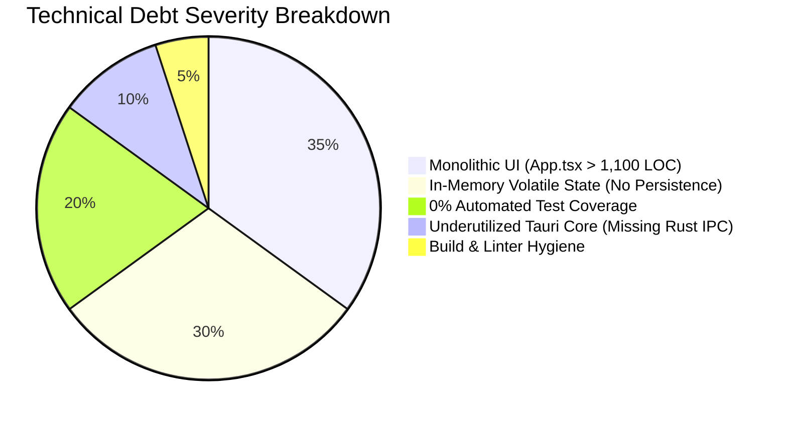
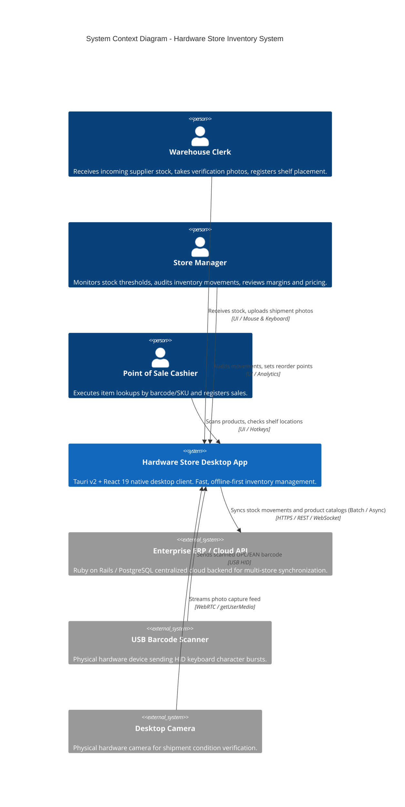
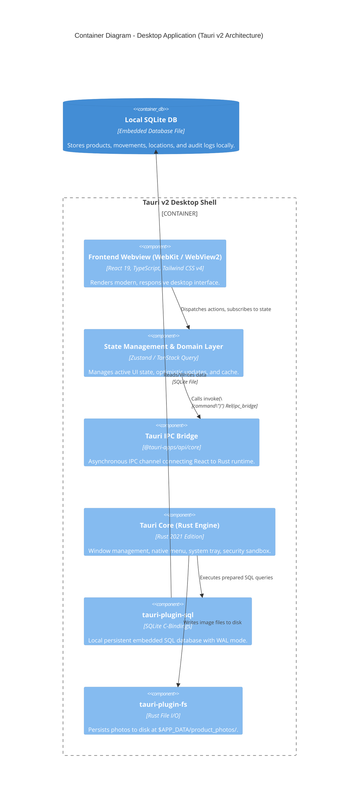
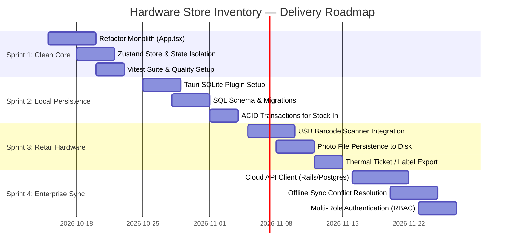

# 📋 Architecture Assessment & Delivery Plan

> **Document Class:** Technical & Delivery Architecture Blueprint  
> **Target Audience:** Engineering Manager (EM), Delivery Manager (DM), Delivery Lead (DL), Product Owner (PO)  
> **System:** Hardware Store Inventory — Native Desktop Application (Tauri v2 + React 19)  
> **Current Version:** 0.2.0 (Prototype Iteration 2)  
> **Status:** Proposal & Execution Roadmap  

---

## 1. Executive Summary & Business Context

### 1.1 Problem Statement
Hardware stores and retail builders\' supply hubs (*ferreterías y corralones*) operate in high-density, physical-first retail environments. Key operational pain points include:
1. **Stock Discrepancies & Stockouts:** Slow manual counts cause sudden inventory depletion of fast-moving SKUs (screws, tools, paint, plumbing fittings).
2. **Physical Warehouse Disorganization:** Products are misplaced across warehouses, aisles, racks, and shelves without recorded coordinates, leading to staff search fatigue.
3. **Unverified Shipments Intake:** Incoming supplier goods are frequently unloaded without photographic proof or immediate stock reconciliation.
4. **Network Unreliability in Warehouse Bays:** Many warehouse basements or yard areas experience spotty Wi-Fi, making purely cloud-dependent web apps unstable.

### 1.2 Strategic Solution
A lightweight, offline-first **Native Desktop Application** built with **Tauri v2 (Rust shell)** and **React 19 + TypeScript**:
- **Offline Resilience:** Zero latency; operates locally even when internet drops.
- **Physical Coordinates:** First-class store coordinates (*Store · Aisle · Rack · Shelf*) for instant physical locating.
- **Auditable Stock Movements:** Double-entry-style logs categorizing every unit change (`PURCHASE`, `SALE`, `RETURN`, `ADJUSTMENT`).
- **Hardware Integration:** Direct desktop camera capture for shipment photographic proof, plus USB barcode scanning.

---

## 2. Technical Debt & "Toy Project" Assessment (Engineering Manager View)

While Iteration 2 achieves functional prototype completeness for demo purposes, the codebase currently suffers from significant architectural shortcuts that prevent it from being production-ready:



### 2.1 Critical Debt Items

| Area | Current State ("Toy Project") | Target State (Production Architecture) | Severity | Refactor Epic |
| :--- | :--- | :--- | :---: | :--- |
| **Monolithic UI Component** | [App.tsx](file:///src/app/App.tsx) has **1,100+ lines**. It mixes routing, layout, modals, drawers, camera streaming, and business calculations in a single component. | Modular feature-based directory structure (`src/features/*`), presentation components (`src/components/ui/*`), and custom hooks. | **CRITICAL** | Epic 1 |
| **State & Persistence** | State is held strictly in memory via React `useState(mockProducts)` and `useState(mockMovements)`. Reloading or closing the application loses all data. | Local relational database using `tauri-plugin-sql` (SQLite) with migrations, WAL mode, and ACID transactions. | **BLOCKER** | Epic 2 |
| **Test Automation** | **0% coverage**. No testing framework installed (no Vitest, React Testing Library, or Playwright). | Vitest unit test suite for domain calculations + React Testing Library for feature flows + Playwright/Tauri WebDriver for desktop E2E. | **HIGH** | Epic 1 |
| **Tauri Core Utilization** | Tauri v2 functions solely as a Webview window shell; no Rust commands or plugins are registered. | Rust layer handles SQLite database connection, system file storage for captured photos, and hardware event listeners. | **HIGH** | Epic 2 & 3 |
| **Photo & Asset Storage** | Camera photos are converted to in-memory Base64 data URLs. This causes memory bloat and potential crash under heavy usage. | Captured images saved to disk via Tauri filesystem API (`$APP_DATA_DIR/photos/`) and referenced via relative file paths. | **MEDIUM** | Epic 3 |
| **Code Quality & Tooling** | No linter configured (`npm run lint` missing); Node 20.17 engine warning under Vite 8; untracked zip artifacts in workspace. | Biome / ESLint + Prettier, Husky pre-commit hooks, strict TypeScript configuration, and GitHub Actions CI matrix. | **MEDIUM** | Epic 1 |

---

## 3. C4 Architecture Specification

### 3.1 C4 Level 1: System Context Diagram



---

### 3.2 C4 Level 2: Container Diagram (Desktop Application Internals)



---

### 3.3 C4 Level 3: Target Component Hierarchy (Refactoring Blueprint)

To resolve the monolithic structure of `src/app/App.tsx`, the presentation layer is decoupled into domain features:

```text
src/
├── app/
│   ├── App.tsx                     # Thin root orchestrator (< 80 LOC)
│   ├── routes.tsx                  # Tab & section routing
│   └── providers.tsx               # Context & store providers
├── features/
│   ├── catalog/
│   │   ├── components/
│   │   │   ├── ProductGrid.tsx
│   │   │   ├── ProductCard.tsx
│   │   │   ├── ProductSearchFilter.tsx
│   │   │   └── CategoryNav.tsx
│   │   └── hooks/useCatalog.ts
│   ├── product-detail/
│   │   ├── components/
│   │   │   ├── ProductDetailDrawer.tsx
│   │   │   ├── StockLevelBadge.tsx
│   │   │   └── ProductMovementHistory.tsx
│   │   └── hooks/useProductDetail.ts
│   ├── inventory-movements/
│   │   ├── components/
│   │   │   ├── InventoryDashboard.tsx
│   │   │   ├── MetricCards.tsx
│   │   │   └── MovementsTable.tsx
│   │   └── hooks/useMovements.ts
│   ├── receive-stock/
│   │   ├── components/
│   │   │   ├── ReceiveStockModal.tsx
│   │   │   ├── LocationPicker.tsx
│   │   │   └── CameraCaptureModal.tsx
│   │   └── hooks/useReceiveStock.ts
│   └── hardware/
│       ├── hooks/useBarcodeScanner.ts
│       └── hooks/useWebcamStream.ts
├── components/ui/                  # Atomic Design UI Components
│   ├── Button.tsx
│   ├── Input.tsx
│   ├── Modal.tsx
│   ├── Drawer.tsx
│   ├── Badge.tsx
│   └── MetricStat.tsx
├── stores/
│   ├── useInventoryStore.ts        # Zustand store for products & movements
│   └── useUiStore.ts               # Modals, drawer, search query
├── services/
│   ├── db/
│   │   ├── client.ts               # SQLite plugin connection
│   │   ├── migrations/             # V1, V2 SQL schema migrations
│   │   └── repositories/
│   │       ├── productRepository.ts
│   │       └── movementRepository.ts
│   └── hardware/
│       └── scannerService.ts
└── types/
    ├── inventory.ts
    └── audit.ts
```

---

## 4. Delivery Roadmap & User Stories (Delivery Lead & DM View)



### 4.1 Detailed User Stories & Story Point Estimations

Estimations follow the **Fibonacci Sequence (1, 2, 3, 5, 8, 13)** based on complexity, uncertainty, and effort.

#### Epic 1: Architectural Refactoring & Test Automation (Sprint 1 — 11 SP)

##### US-01: Modularización de UI y Desacoplamiento de Componentes
- **ID:** US-01
- **Story Points:** **5 SP**
- **Persona:** Como *Desarrollador del equipo*, quiero descomponer `App.tsx` en módulos autocontenidos para poder implementar nuevas features sin riesgo de colisiones de merge ni efectos secundarios.
- **Criterios de Aceptación (Gherkin):**
  - **Given** el archivo `src/app/App.tsx` con más de 1.100 líneas.
  - **When** se modulariza la aplicación bajo `src/features/*` y `src/components/ui/*`.
  - **Then** `App.tsx` no supera las 100 líneas y se limita a montar providers y el layout base.
  - **And** ninguna funcionalidad visual o interactiva sufre regresión visual o de comportamiento.

##### US-02: State Management Centralizado con Zustand
- **ID:** US-02
- **Story Points:** **3 SP**
- **Persona:** Como *Ingeniero Frontend*, quiero mover la lógica de productos y movimientos a un store de Zustand para evitar el prop-drilling y aislar la lógica de cálculo de stock.
- **Criterios de Aceptación:**
  - Todo cambio de stock y registro de movimiento se despacha mediante acciones tipadas (`receiveStock()`, `filterProducts()`).
  - Los cálculos de stock remanente y alertas de seguridad se computan mediante selectores memorizados.

##### US-03: Setup de Testing Automatizado con Vitest y Testing Library
- **ID:** US-03
- **Story Points:** **3 SP**
- **Persona:** Como *Engineering Manager*, quiero una suite de tests automatizados para validar que las fórmulas de inventario no fallen ante cambios de código.
- **Criterios de Aceptación:**
  - `npm test` ejecuta Vitest y produce un informe de cobertura.
  - Se cubren al 100% las funciones puras de cálculo de stock, formateo de moneda y validación de coordenadas de estantería.
  - Se añade un test de integración para el flujo de recepción de stock.

---

#### Epic 2: Persistencia Local y Confiabilidad Offline-First (Sprint 2 — 16 SP)

##### US-04: Implementación de Base de Datos Local SQLite con Tauri
- **ID:** US-04
- **Story Points:** **8 SP**
- **Persona:** Como *Encargado de Depósito*, quiero que los productos y movimientos se guarden permanentemente en mi máquina para que los datos nunca se pierdan al reiniciar la computadora.
- **Criterios de Aceptación:**
  - Tauri inicializa una base SQLite local (`hardware_store.db`) al iniciar la aplicación.
  - El esquema incluye llaves foráneas e índices sobre `sku`, `barcode` y `created_at`.
  - Los seed data se insertan únicamente si la base de datos se encuentra vacía.

##### US-05: Transacciones Atómicas en Recepción de Stock
- **ID:** US-05
- **Story Points:** **5 SP**
- **Persona:** Como *Auditor de Inventario*, quiero que el ingreso de mercadería actualice el stock y registre el movimiento de auditoría en una transacción atómica para evitar desincronizaciones de balance.
- **Criterios de Aceptación:**
  - La inserción en `stock_movements` y el `UPDATE` en `products.stock` ocurren dentro de una transacción `BEGIN...COMMIT`.
  - Si ocurre un fallo en cualquier paso, la base de datos ejecuta `ROLLBACK` y la UI notifica el error sin alterar los contadores.

##### US-06: Exportación de Auditoría y Reportes (CSV / Excel)
- **ID:** US-06
- **Story Points:** **3 SP**
- **Persona:** Como *Delivery Lead / Store Manager*, quiero exportar la tabla de movimientos y el balance de stock a formato CSV para compartirlo con contabilidad.
- **Criterios de Aceptación:**
  - Botón de exportación en la vista de Inventario.
  - Generación instantánea de archivo CSV con codificación UTF-8 compatible con Microsoft Excel.

---

#### Epic 3: Periféricos de Tienda y Hardening Operativo (Sprint 3 — 13 SP)

##### US-07: Listener Global de Código de Barras USB (HID)
- **ID:** US-07
- **Story Points:** **5 SP**
- **Persona:** Como *Cajero / Recepcionista*, quiero escanear productos con mi pistola lectora USB sin tener que hacer click previamente en el campo de búsqueda.
- **Criterios de Aceptación:**
  - La app escucha ráfagas rápidas de pulsaciones de teclado finalizadas con tecla `Enter` (< 50ms entre caracteres).
  - Si coincide con un código de barras existente, abre automáticamente el drawer del producto o lo selecciona en el modal de recepción.

##### US-08: Persistencia de Fotografías de Envío en Disco Nativo
- **ID:** US-08
- **Story Points:** **5 SP**
- **Persona:** Como *Gerente de Compras*, quiero que las fotos de remitos y mercadería se guarden como archivos en el disco para no saturar la base de datos con cadenas Base64.
- **Criterios de Aceptación:**
  - La captura de cámara se envía al backend Tauri en Rust y se escribe en el directorio seguro `$APP_DATA/shipment_photos/{uuid}.webp`.
  - La base de datos almacena únicamente la ruta local del archivo.

##### US-09: Resiliencia de Permisos de Cámara y Manejo de Errores de Hardware
- **ID:** US-09
- **Story Points:** **3 SP**
- **Persona:** Como *Usuario de Mostrador*, quiero recibir mensajes claros si la cámara web no está conectada o no tiene permisos de sistema, pudiendo continuar la operación mediante adjunto de archivo.
- **Criterios de Aceptación:**
  - Captura de excepciones de `NotAllowedError` y `NotFoundError` de WebRTC.
  - Fallback automático hacia explorador de archivos nativo sin bloquear la recepción de stock.

---

#### Epic 4: Sincronización Cloud y Multi-Sucursal (Sprint 4 — 21 SP)

##### US-10: Cliente de Sincronización Cloud Offline-First
- **ID:** US-10
- **Story Points:** **13 SP**
- **Persona:** Como *Director de Operaciones*, quiero que las sucursales sincronicen sus stocks con una API central (Rails/Postgres) cuando haya conexión a internet disponible.
- **Criterios de Aceptación:**
  - Cola de sincronización local que encola eventos cuando no hay conexión.
  - Sincronización en segundo plano con estrategia de resolución de conflictos *Last-Write-Wins* o reconciliación de deltas basada en timestamps UTC.

##### US-11: Control de Acceso y Perfiles (RBAC)
- **ID:** US-11
- **Story Points:** **8 SP**
- **Persona:** Como *Delivery Manager*, quiero restringir la edición de precios y costos a usuarios con rol Manager, permitiendo a los empleados de depósito únicamente recibir mercadería.
- **Criterios de Aceptación:**
  - Roles definidos: `ADMIN`, `STORE_MANAGER`, `WAREHOUSE_CLERK`, `CASHIER`.
  - Ocultamiento y protección a nivel componente de acciones no autorizadas.

---

## 5. Resumen de Capacidad y Estimaciones

| Sprint | Enfoque Principal | Total SP | Esfuerzo Estimado |
| :--- | :--- | :---: | :---: |
| **Sprint 1** | Refactor Arquitectural, Desacoplamiento de `App.tsx`, Vitest & Linter | **11 SP** | 2 Semanas (1 Dev Senior) |
| **Sprint 2** | Persistencia Local SQLite, Transaccionalidad ACID y Exportación CSV | **16 SP** | 2 Semanas (1 Dev Fullstack) |
| **Sprint 3** | Integración de Hardware (USB Scanner, Webcam a disco, Fallbacks) | **13 SP** | 2 Semanas (1 Dev Fullstack) |
| **Sprint 4** | Sincronización Cloud Offline-First (Rails/Postgres) y Roles RBAC | **21 SP** | 3 Semanas (2 Devs) |
| **Total** | **Roadmap Completo de Producción** | **61 SP** | **~9 Semanas** |

---

## 6. Definition of Ready (DoR) & Definition of Done (DoD)

### Definition of Ready (DoR)
1. Historia especificada en formato *User Story* con criterios de aceptación claros (Gherkin).
2. Wireframes o capturas de referencia disponibles (e.g. `docs/screenshots/*`).
3. Dependencias de hardware o backend identificadas y mockeadas si fuera necesario.
4. Estimación en Story Points asignada por el equipo técnico.

### Definition of Done (DoD)
1. Código cumple con estándares de linting y formateo automático sin warnings.
2. Cobertura de tests unitarios/integración añadida para la nueva lógica (>= 80%).
3. Verificación de compilación exitosa tanto en modo web (`npm run build`) como en Tauri desktop (`npm run tauri dev`).
4. Documentación o CHANGELOG actualizado.
5. Pull Request revisado y aprobado por al menos un par técnico antes de merge a `main`.

---

## 7. Matriz Integral de Riesgos y Mitigación

| ID | Riesgo Operativo / Técnico | Prob. | Impacto | Estrategia de Mitigación Preventiva | Plan de Contingencia |
| :---: | :--- | :---: | :---: | :--- | :--- |
| **R-01** | **Pérdida de datos por crash o cierre abrupto de la app** | Alta | Crítico | Migración inmediata a SQLite con transacciones atómicas (Sprint 2). | Backup diario automático del archivo `.sqlite`. |
| **R-02** | **Regresiones funcionales al partir `App.tsx`** | Alta | Alto | Escribir tests de integración de componentes antes de extraer subcomponentes. | Refactor paso a paso por componentes aislados en ramas dedicadas. |
| **R-03** | **Fallo o retraso en lectura de scanners USB de modelos antiguos** | Media | Medio | Utilizar event listener agnóstico al SO midiendo el delta temporal entre keydowns. | Permitir tipeo manual asistido con foco rápido (tecla rápida `F2`). |
| **R-04** | **Permisos de cámara bloqueados por políticas de OS (macOS/Windows)** | Media | Bajo | Desacoplar la foto como paso obligatorio; permitir adjuntar fotos por archivo. | Modal de ayuda guiado con instrucciones de permisos de privacidad del sistema. |
| **R-05** | **Conflictos de concurrencia en stock multi-sucursal** | Media | Crítico | Diseñar el modelo de datos basado en **Deltas de Movimiento** (Append-Only Log) en lugar de sobrescribir el valor absoluto de stock. | Algoritmo de reconciliación determinista en backend. |

---

*Documento preparado para revisión y aprobación por el equipo de Delivery y Engineering.*
