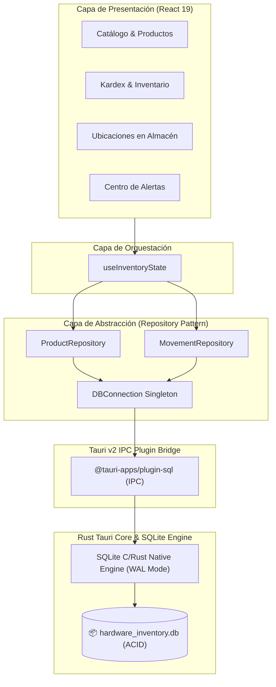

# 📋 Plan 10: Auditoría de Proficiencia, Arquitectura & Persistencia Local SQLite (Tauri v2 + React 19)

> **Epic:** Persistencia Nativa, Resiliencia & Preparación para Producción  
> **Feature:** `tauri-plugin-sql`, `src-tauri` & `src/services/db/`  
> **Branch Objetivo:** `feat/09-feature-sqlite-persistence` (basada en `development`)  
> **Target:** `development`  
> **Status:** En Planificación ⏳  

---

## 🎯 Objetivo y Criterios de Éxito

Transicionar el sistema de almacenamiento volátil en memoria (`mockProducts` y `mockMovements` en `useState`) hacia un **motor relacional local de producción** con persistencia real, transacciones ACID y recuperación ante fallos:

- [ ] **Selección del Motor de Base de Datos:**
  - [x] Estudio comparativo completado: **SQLite** seleccionado como estándar de oro para aplicaciones comerciales de escritorio en Tauri (embebido en el binario nativo, cero configuración externa, portable en un único archivo `.db`, modo WAL de alto rendimiento y cero mantenimiento para el usuario).
  - [x] Descarte justificado de PostgreSQL y MS SQL Server para el escenario desktop local (complejidad operacional, servicios daemon de fondo y alto consumo de RAM).
- [ ] **Infraestructura de Datos Nativa en Tauri v2:**
  - [ ] Integrar `tauri-plugin-sql` con el driver `sqlite` en `src-tauri/Cargo.toml` y `@tauri-apps/plugin-sql` en el frontend.
  - [ ] Configurar almacenamiento seguro en la ruta de datos de aplicación nativa del sistema operativo (`AppLocalDataDir`).
  - [ ] Configurar directivas de rendimiento y robustez: `PRAGMA journal_mode = WAL;` y `PRAGMA foreign_keys = ON;`.
- [ ] **Esquema Relacional & Sistema de Migraciones:**
  - [ ] Definir tablas normalizadas: `categories`, `locations`, `products` y `stock_movements`.
  - [ ] Migración inicial automatizada (`001_init_schema.sql`).
  - [ ] Hidratación inicial (*seeding*) desde los mocks existentes (`products.json` y `mockMovements`) en la primera ejecución si la base está nueva.
- [ ] **Capa de Abstracción & Repositorios (Repository Pattern):**
  - [ ] Implementar `src/services/db/connection.ts` (conexión singleton segura).
  - [ ] Implementar `src/services/db/productRepository.ts` (consultas y mutaciones de catálogo).
  - [ ] Implementar `src/services/db/movementRepository.ts` (asientos de Kardex, transacciones y filtros).
- [ ] **Integración en el Estado Global (`useInventoryState.ts`):**
  - [ ] Carga inicial asíncrona desde SQLite con indicador de hidratación (`isLoading`).
  - [ ] Operaciones de mutación (`createProduct`, `adjustStock`, `receiveStock`, `relocateProduct`) ejecutadas en SQLite mediante transacciones atómicas antes de actualizar el estado en memoria.
- [ ] **Copias de Seguridad (Backup & Restore):**
  - [ ] Funcionalidad para exportar copia de respaldo de la base `.db`.
  - [ ] Funcionalidad para restaurar desde un archivo `.db`.
- [ ] **Calidad & Resiliencia:**
  - [ ] Verificación con `tsc -b && npm run build` y `cargo check` con 0 errores.

---

## 🗄️ Arquitectura de Persistencia & Comparativa de Motores

### Tabla Comparativa Técnica:

| Criterio | **SQLite** (Seleccionado) | **PostgreSQL** | **Microsoft SQL Server** |
| :--- | :--- | :--- | :--- |
| **Arquitectura** | **Embebido** (Corre en el binario). | **Cliente-Servidor** (Daemon externo). | **Cliente-Servidor** (Daemon pesado). |
| **Instalación** | **Zero-Config** (Sin instalador ni credenciales). | Requiere instalar y configurar servicio. | Instalador corporativo de gigabytes. |
| **Consumo RAM** | Insignificante ($\approx 5\text{ MB}$). | Moderado ($\approx 150\text{ MB}$). | Muy alto ($\approx 1\text{ GB}+$). |
| **Backups** | **Copiar un archivo** (`.db`). | Requiere `pg_dump` y scripts. | Requiere archivos `.mdf` y SSMS. |
| **Tauri v2** | Nativo (`tauri-plugin-sql`). | Requiere conexión de red a daemon. | Requiere driver ODBC / TDS de red. |

---

## 🧩 Checklist de Tareas por Fases

### Fase 1: Infraestructura de Plugin & Dependencias - [COMPLETADO ✅]
- [x] **Tarea 1.1:** Añadir `tauri-plugin-sql = { version = "2", features = ["sqlite"] }` en `src-tauri/Cargo.toml`.
- [x] **Tarea 1.2:** Registrar el plugin en `src-tauri/src/lib.rs`.
- [x] **Tarea 1.3:** Instalar `@tauri-apps/plugin-sql` en `package.json`.
- [x] **Tarea 1.4:** Validar compilación nativa con `cargo check` y `npm run build`.

### Fase 2: Esquema Relacional, Migraciones & Seeding - [COMPLETADO ✅]
- [x] **Tarea 2.1:** Diseñar script de migración DDL (`schema.ts`):
  - `products` (id, sku, barcode, name, brand, category, unit, price, cost, stock, minimum_stock, location_store, location_aisle, location_rack, location_shelf, description, image, created_at, updated_at).
  - `stock_movements` (id, product_id, type, quantity, unit_cost, location_store, location_aisle, location_rack, location_shelf, note, created_at).
  - Índices automáticos para SKU, Categoría, Pasillo y Kardex (`created_at DESC`).
- [x] **Tarea 2.2:** Crear servicio de inicialización y migración automática al arrancar la app (`connection.ts`).
- [x] **Tarea 2.3:** Crear script de *seeding* que inserte los datos actuales de `products.json` y `mockMovements` únicamente si la base SQLite está recién creada (`seeder.ts`).

### Fase 3: Capa de Repositorios (Repository Pattern) - [COMPLETADO ✅]
- [x] **Tarea 3.1:** Crear `src/services/db/connection.ts` con manejo de conexión única y reintentos.
- [x] **Tarea 3.2:** Crear `src/services/db/productRepository.ts` con métodos tipados:
  - `loadAllProducts(): Promise<Product[]>`
  - `insertProduct(product: Product): Promise<void>`
  - `updateProductStock(productId: string, newStock: number): Promise<void>`
  - `updateProductLocation(productId: string, location: ProductLocation): Promise<void>`
  - `getProductById(productId: string): Promise<Product | null>`
- [x] **Tarea 3.3:** Crear `src/services/db/movementRepository.ts` con métodos tipados:
  - `loadAllMovements(): Promise<StockMovement[]>`
  - `insertMovement(movement: StockMovement): Promise<void>`
  - `getMovementsByProductId(productId: string): Promise<StockMovement[]>`

### Fase 4: Integración en `useInventoryState.ts` & UI - [COMPLETADO ✅]
- [x] **Tarea 4.1:** Añadir bandera `isDbLoading: boolean` y pantalla de carga con feedback reactivo en `App.tsx`.
- [x] **Tarea 4.2:** Reemplazar el estado inicial sincrónico `useState(mockProducts)` por carga asíncrona desde SQLite vía `productRepository` y `movementRepository`.
- [x] **Tarea 4.3:** Actualizar `createProduct`, `adjustStock`, `receiveStock` y `relocateProduct` para persistir en SQLite mediante llamadas a repositorios con manejo de errores y rollback en caso de fallo.
- [x] **Tarea 4.4:** Añadir utilidad de exportación y respaldo de la base (`exportDatabaseBackup` en `backup.ts` y botón en `Sidebar.tsx`).

### Fase 5: Verificación de Calidad, Resiliencia & Gitflow
- [ ] **Tarea 5.1:** Ejecutar `tsc -b`, `npm run build` y `cargo check`.
- [ ] **Tarea 5.2:** Probar persistencia real cerrando completamente la app nativa y reabriéndola tras crear productos y realizar ajustes.
- [ ] **Tarea 5.3:** Abrir PR hacia `development`, verificar Quality Gates de CI y fusionar.
